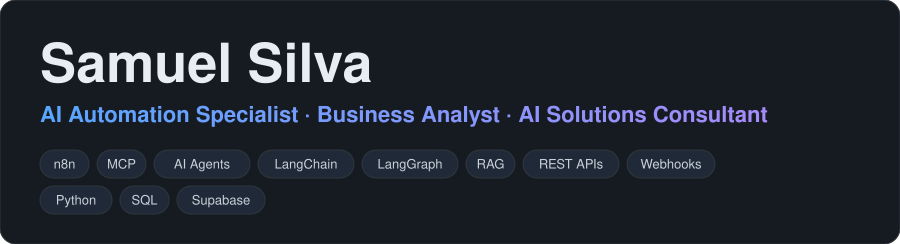
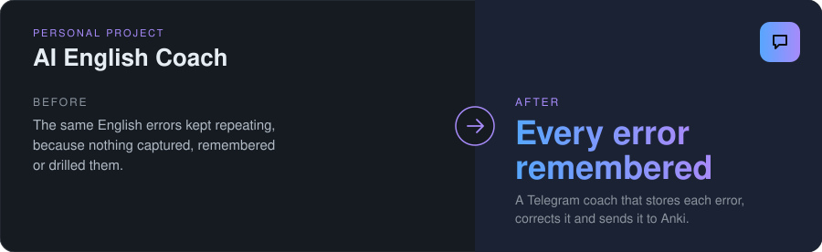

## About me

I'm the bridge between business and technology. After 8+ years in business operations, I know where processes break, and I use that to decide what is worth automating before building anything. I map the process, define the requirements with the people who live it, and then build the automation or AI agent that solves it, mostly with n8n, Python and LLM tooling.

I like the part where a vague business pain has to become a working system: framing the problem, choosing the simplest technical solution that works, and setting a baseline so I can show whether it worked.

Most of my production work lives in private company systems, so this page grows as I publish cases and sanitized examples.

<!--
HIGHLIGHT NUMBERS (hidden until the data is consolidated)

To show this block:
1. Open _templates/stats-template.svg, edit the three numbers and labels, and save it as assets/stats.svg.
2. Upload assets/stats.svg to the repository.
3. Remove the opening and closing comment markers around the image tag below.

-->

## Cases

**The idea.** Intermediate learners rarely fail on grammar rules. They fail on friction errors, such as literal translations and weak word combinations, that repeat for years because nothing captures, remembers and drills them. I built a coach that does all three, in the app where I already chat every day.

<b>How it was solved</b>

**Business problem.** A recurring, silent error pattern with no feedback loop. The requirements: catch the error where the learner already writes, remember it across sessions, correct it in a useful way, and put it where it gets reviewed.

**Technical solution.**

- A Telegram bot takes text or voice notes. Voice is transcribed and answered back with audio.
- A LangGraph pipeline first recalls the learner's past errors from a vector database, then classifies the message: rewrite, search or casual chat.
- For a friction error, the coach returns three rewrites at C1 level (casual, professional, idiomatic). For a meaning question, it pulls real usage examples from the web.
- Every detected error is stored back in memory, and at the end of a session the errors are exported to Anki as flashcards.

**Guardrails.**

- Every external service has a timeout and a fallback, so a failing dependency degrades the answer instead of breaking the bot.
- The Anki export queue is cleared only after a fully successful export.
- Each learner's memory is isolated by a filter on the user.

**Honest limits.** The message classifier is rule-based by design. Replacing it with an LLM classifier is the next planned step.

**Who uses it.** Built for my own English practice, to consolidate agent development skills on a problem I actually have.

`Python` `LangGraph` `Groq` `Qdrant` `sentence-transformers` `Tavily` `AnkiConnect` `Telegram Bot API` `LangSmith` `Pydantic`

[View the repository](https://github.com/samuel-andrade-silva/ai-english-coach)

<!--
Add new cases here, below the one above. Copy the structure from _templates/case-template.md.

SMALLER TOOLS (hidden, for later)
Use this for useful things that don't deserve a full case. Remove the comment markers to show it.

## Smaller tools

| What | What it does | Status |
|---|---|---|
| Name of the tool | One line on the problem it solves. | In use |

EXPERIMENTS (hidden, for later)
Use this for things you explore outside the day job: a demo, an article, a study project. Remove the comment markers to show it.

## Experiments

One short paragraph on what you tried, what you learned, and a link.
-->

Reach me on [LinkedIn](https://www.linkedin.com/in/samuel-andrade-da-silva).
